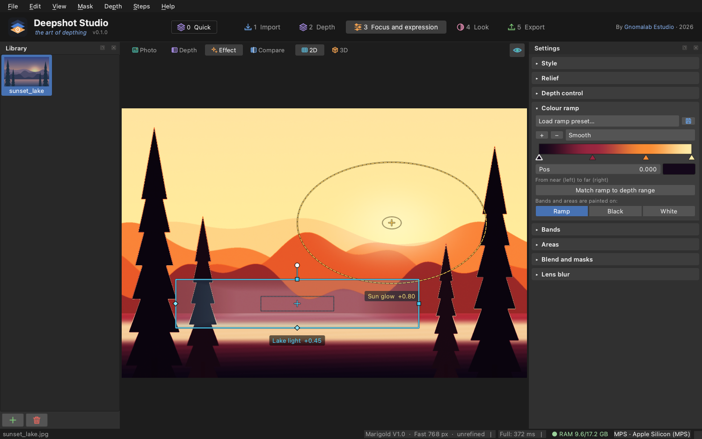

# Deepshot Studio

*The art of depthing.*

Deepshot Studio is a desktop application that creates images from the **depth** of a photograph. It estimates a depth map
with a local diffusion model, lets you shape it (tone ramp, depth bands, 3D areas, lens blur), finishes the result with a
stack of effects and exports it at full resolution.

Everything runs **locally**: no telemetry, no external APIs at run time. The only download is the model weights from
Hugging Face the first time you use a model, and they stay in a local folder next to the program.

> Status: 0.1.0, alpha. Personal use for now; the code is organised so it can be packaged later.



New here? Read the [illustrated guide](docs/GUIDE.md): a short tour of every part of the interface, with screenshots.

## Features

1. **Import**: drag photos in, see their EXIF information and, if you only need part of a big photo, **reframe** to work
   on that area without touching the original file.
2. **Depth**: estimate the map with [Marigold V1.0](https://github.com/prs-eth/Marigold) (diffusers, Apache-2.0), its fast
   LCM variant or Depth Anything V2 Small, or load a map made elsewhere. Quality presets, edge refinement guided by the
   photo, and a list of previous computations (with real timings) to compare.
3. **Shape the effect**:
   - Colour ramp, with presets.
   - Depth bands with pan and tilt (up to ±89°), editable in 2D and with handles in 3D.
   - Ellipsoid or box areas that lighten or darken, edited on the image and in 3D.
   - Depth control (move near, middle and far zones), lens blur with real bokeh, blend with the photo and masks
     (depth range or painted with a brush).
   - A 3D view of the relief to place everything in space.
4. **Look**: a Photoshop-style stack of effects (levels, contrast, saturation, grain, sharpen, vignette, clarity, glow,
   chromatic aberration, depth haze, temperature), with factory and user looks. Downloadable **modules** add heavier
   tools: depth relighting, background removal (SAM 2.1) and super-resolution (Swin2SR).
5. **Export**: the effect, the depth map (grey or colour) or the final image, as PNG 8/16 bit, EXR 32 bit, JPG, TIFF or
   WebP, at full resolution or any size you choose.

Layer lists (bands, areas, effects) work like a layer panel: an eye to bypass each item, a **solo** button, a colour
square, rename in place, and reorder by dragging.

The interface is in English (default) or Spanish, chosen in Preferences, with dark, light and midnight themes plus your
own.

## Requirements

- Windows 10/11 (main target) or macOS on Apple Silicon (M1 or later). Python 3.11 to 3.13.
- A GPU is optional but recommended: CUDA on NVIDIA (Windows), MPS on Apple Silicon. It falls back to CPU.
- 16 GB of RAM is comfortable. Marigold needs about 4 to 5 GB of GPU memory.
- [uv](https://docs.astral.sh/uv/) to create the environment.

## Install

```bash
git clone https://github.com/Gnomalab/deepshot-studio.git
cd deepshot-studio
uv venv --python 3.12 .venv
uv pip install --python .venv -e ".[dev]"
```

On Windows, PyTorch comes from the CUDA 12.8 index defined in `pyproject.toml`; on macOS it comes from PyPI with MPS support.

## Run

```bash
.venv/bin/python -m deepshot          # macOS / Linux
.venv\Scripts\python -m deepshot      # Windows
```

Models are installed from the built-in **Model and module manager** (Ctrl+M) into the `models/` folder. On a Mac, start with
Marigold V1.0 and Depth Anything V2 Small.

## Tests

```bash
.venv/bin/python -m pytest            # use QT_QPA_PLATFORM=offscreen on a machine without a display
```

## Project layout

- `deepshot/`: the application (`depth.py`, `models.py`, `tonemap.py`, `areas.py`, `look.py`, `dof.py`, `export.py`, `ui/`…).
- `modules_catalog/`: downloadable Look modules (`module.json` + `module.py`); see its `README.md`.
- `resources/`: icons, themes and translations. `tests/`: the test suite.
- [`docs/GUIDE.md`](docs/GUIDE.md): the illustrated guide; `tools/make_screenshots.py` regenerates its screenshots.
- [`ROADMAP.md`](ROADMAP.md): phases, decisions and what is left to do (in Spanish).
- [`CLAUDE.md`](CLAUDE.md): working notes for the AI assistant used on this project (in Spanish).

## Licences

Only dependencies and models with licences compatible with commercial use are accepted (MIT, BSD, Apache-2.0 and similar;
LGPL only dynamically linked). Test-only models with non-commercial licences are clearly marked in the app and are not
part of the final offer. Every dependency and model is listed in [`THIRD_PARTY_LICENSES.md`](THIRD_PARTY_LICENSES.md).

PySide6 (LGPL-3.0) is used for the interface. No PyQt, no GPL components at run time.

## Credits

Inspired by a depth-based imaging technique by Karim Joseph Nassar. Deepshot Studio is an independent project with no
affiliation with the author; the full citation and the credits for Marigold and the other libraries are in the **About**
dialog of the application.

By Juanjo Fernández, [Gnomalab Estudio](https://www.gnomalab.es).
