# Deepshot Studio: quick illustrated guide

A short tour of the interface, step by step. The work follows five steps, shown in the top bar (**Alt+1 … Alt+5**):

**1 Import → 2 Depth → 3 Focus and expression → 4 Look → 5 Export**

> The screenshots use a sample scene generated by code, so they contain no personal photos. They can be regenerated at any
> time with `python tools/make_screenshots.py` (see [Regenerating the screenshots](#regenerating-the-screenshots)).

## 1. Import

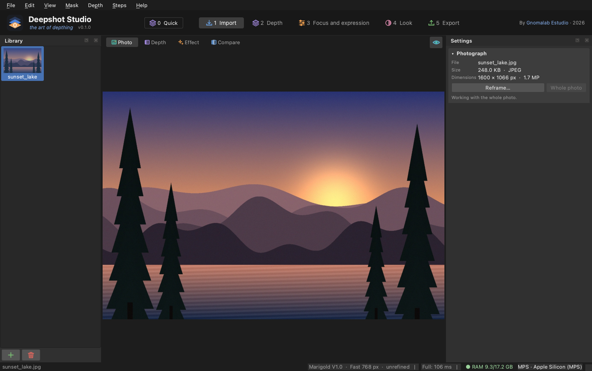

Drag photos onto the window or use **File › Import photograph** (Ctrl+O). They appear in the **Library** on the left; click
one to work with it.

The **Settings** panel on the right shows the photo information (file, size, dimensions, and camera, lens and exposure when
the file has EXIF data; the GPS location stays hidden until you show it). **Reframe…** lets you work on just one area of the
photo, without touching the original file, so a big photo is not computed whole. **Whole photo** removes the framing.

## 2. Depth

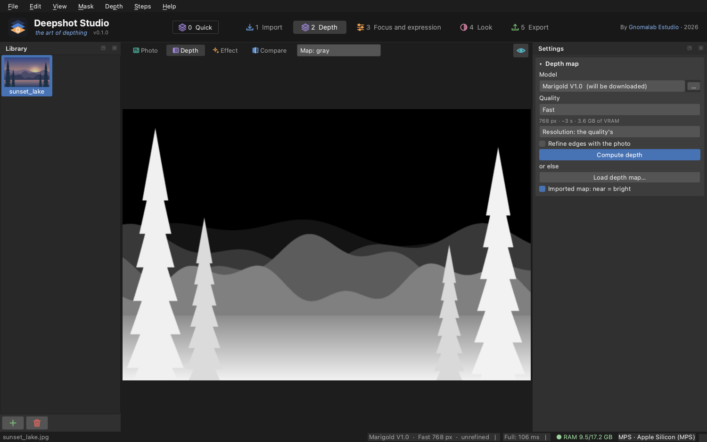

**Compute depth** (Ctrl+D) estimates the depth map with the chosen model. The first time, the model is downloaded (about 2.6 GB
for Marigold V1.0) and from then on it works offline.

- **Quality**: *Fast* to try things out, *High* to work, *Maximum* for the final result. Every map is cached.
- **Refine edges with the photo** fits the contours of the map to those of the photo.
- **Load depth map…** brings in a map made elsewhere. **Imported map: near = bright** sets the convention.
- Each computation stays in a list with the time it really took, so you can compare models and qualities.

On screen, **near = bright** and **far = dark**.

## 3. Focus and expression

Here you shape the effect. The **Effect** view updates instantly. The panel on the right has one collapsible section per tool.

### Colour ramp

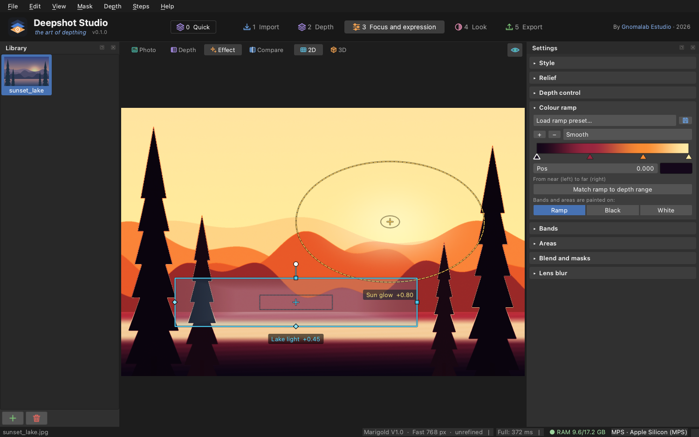

The ramp turns depth into colour, from near (left) to far (right). Drag the stops, double-click a stop to change its colour
while watching the live result, and double-click the bar to add one. **Load ramp preset…** brings factory ramps (you can save
your own with the disk icon). Hover over the list to preview a preset without applying it. The **Bands and areas are painted
on** switch chooses the base: the ramp, black or white.

### Bands

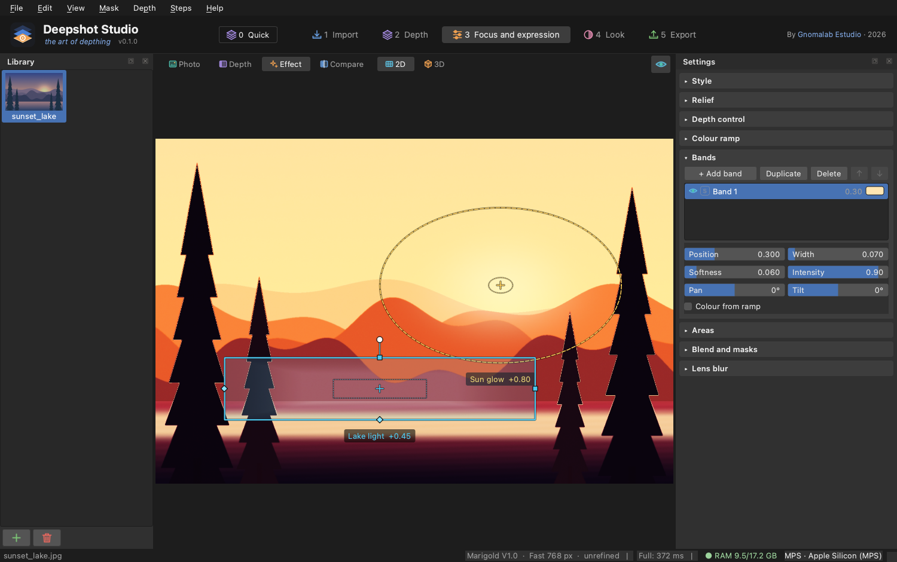

Depth stripes that light up (or tint) over the base. Each band has position, width, softness, intensity and the **Pan** and
**Tilt** rotations (up to ±89°), which tilt the stripe like a plane. Every row of a layer list has the same controls:

- the **eye** applies or bypasses the item;
- the **S** shows only that item in the preview (one at a time; it does not change what is exported);
- double-click the name (or press F2) to rename it, and click the **colour square** to change its colour;
- reorder with the **arrows** or by dragging the row.

### Areas

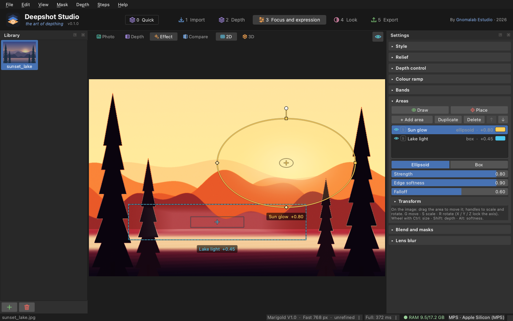

Ellipsoids or boxes in 3D that lighten (positive strength) or darken (negative). Edit them on the image: **Draw** (Shift+A)
and **Place** (P), drag to move, use the squares to scale and the circle to rotate. With the mouse over the image, **G** moves,
**S** scales and **R** rotates (X / Y / Z lock the axis). The dotted inner ring shows where the edge starts to fade.

### Blend and masks

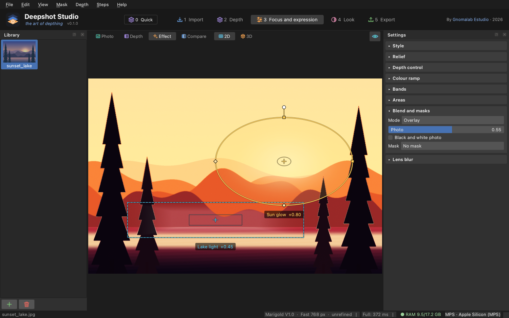

Adds the photo on top with a blend mode, an opacity and, if you want, a mask: the areas, a depth range or a mask you paint
with the brush (B brush, E eraser, [ and ] for the size).

### Lens blur

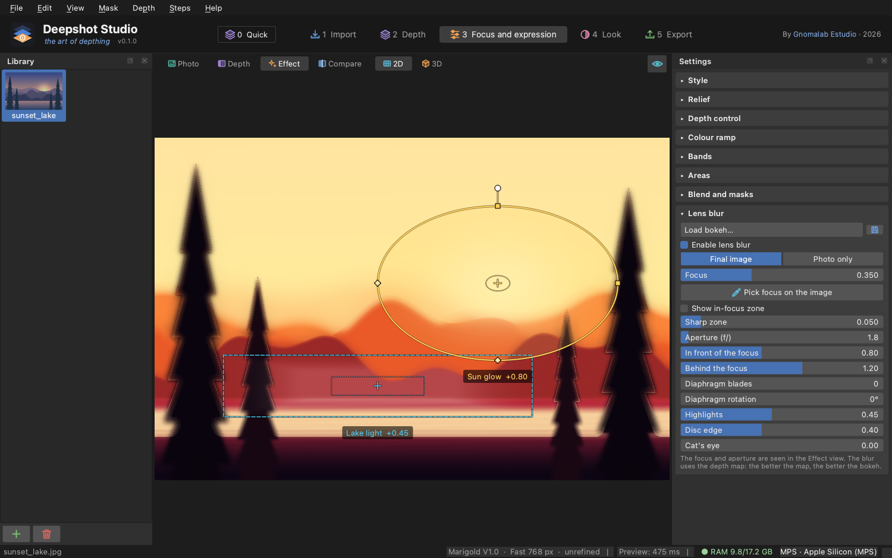

Blurs what is far from the focus depth, like a real camera: pick the **focus** (the eyedropper picks it on the image), the
**aperture** and the **diaphragm** (round or 3 to 12 blades). **Load bokeh…** brings presets such as portrait, macro or cinema.

### 3D view and Compare

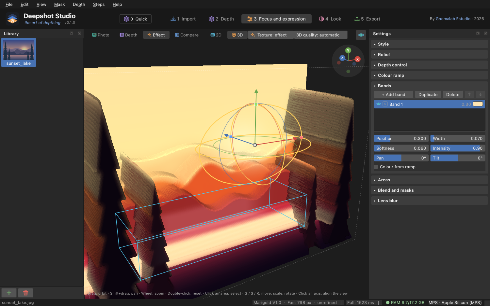

The **2D | 3D** switch shows the relief of the depth map in 3D. Drag to orbit, Shift+drag to pan, wheel to zoom, double-click
to reset. Areas have handles in 3D (arrows to move, squares to scale, rings to rotate), and the selected band has its own:
the arrow moves it in depth, the circles turn Pan and Tilt and the square changes its thickness.

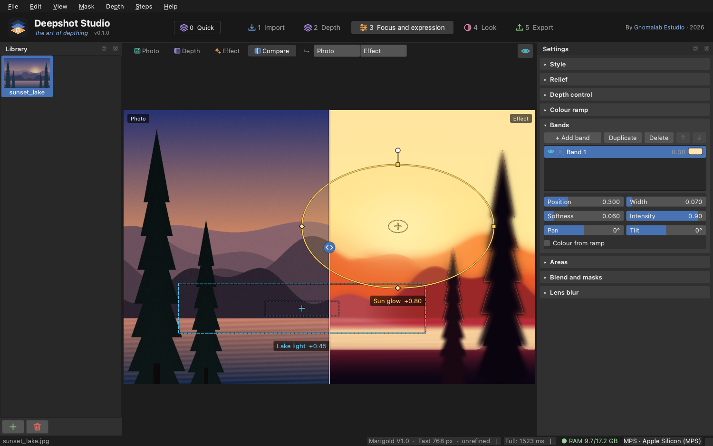

**Compare** splits the view between the photo and the effect; drag the blue handle to move the divider.

Other sections of this step: **Style** (complete starting looks), **Relief** (depth scale and perspective) and **Depth control**
(moves the near, middle and far zones of the map independently).

## 4. Look

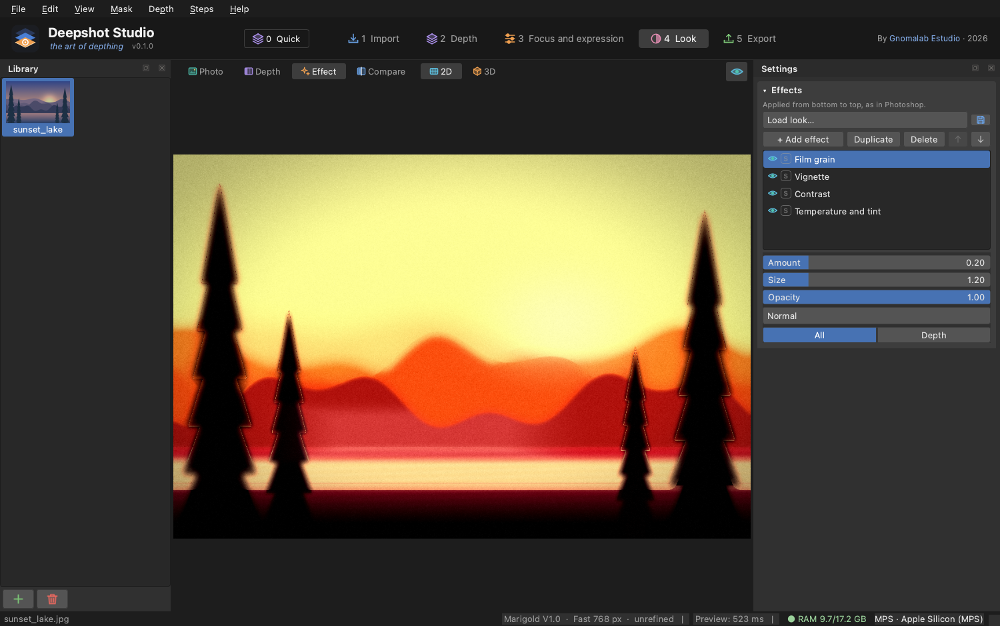

An optional finish: a stack of **effects** applied from bottom to top, as in Photoshop (levels, contrast, saturation, grain,
sharpen, vignette, clarity, glow, chromatic aberration, depth haze and temperature). Each effect can be limited to a depth
range, blended with an opacity and a blend mode, renamed and reordered. **Load look…** brings factory looks, made only with
built-in effects, and you can save your own.

## 5. Export

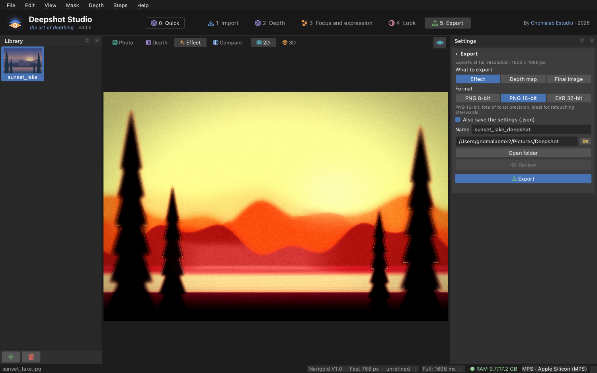

Choose **Effect**, **Depth map** or **Final image** (the effect with the Look applied), then the format (PNG 8 or 16 bit, EXR
32 bit, and for the final image also JPG, TIFF or WebP), the folder and the name. Everything is saved at full resolution and an
existing file is never overwritten. The effect can also save its settings in a `.json` file.

## Models and modules

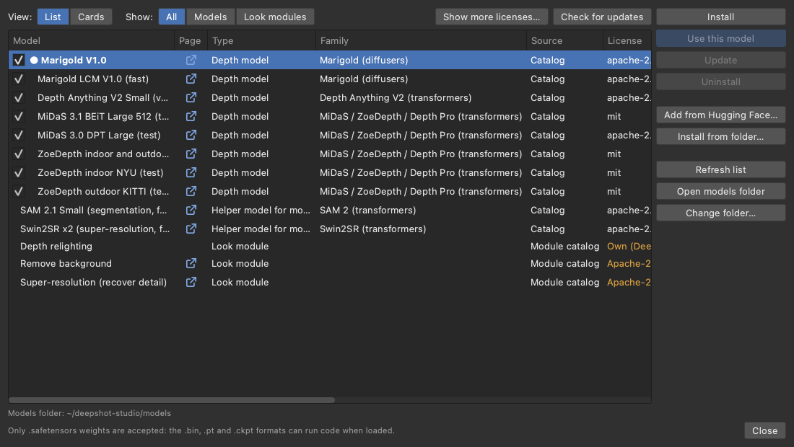

**Depth › Model and module manager** (Ctrl+M) downloads, installs and deletes depth models, and installs **Look modules**: depth
relighting, background removal and super-resolution. Only `.safetensors` weights are accepted. Modules are code, so the
application asks you to approve a module the first time you install it.

## Saving your work

**File › Save project** (Ctrl+S) stores the whole library (photos by path, maps, settings and masks) in a `.deepshot` file.
Everything can be undone with Ctrl+Z.

## Regenerating the screenshots

```bash
QT_QPA_PLATFORM=offscreen .venv/bin/python tools/make_screenshots.py
```

The script draws a landscape and its depth map in code, loads them as an imported map, applies factory presets and saves
each screen to `docs/images/`. It uses a temporary data folder, so it does not touch your own settings. Re-run it after
changing the interface.
